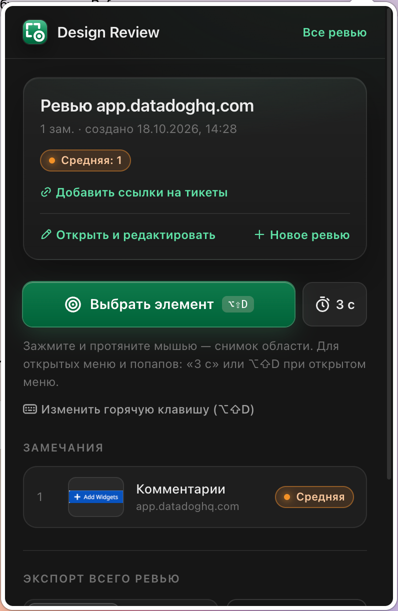
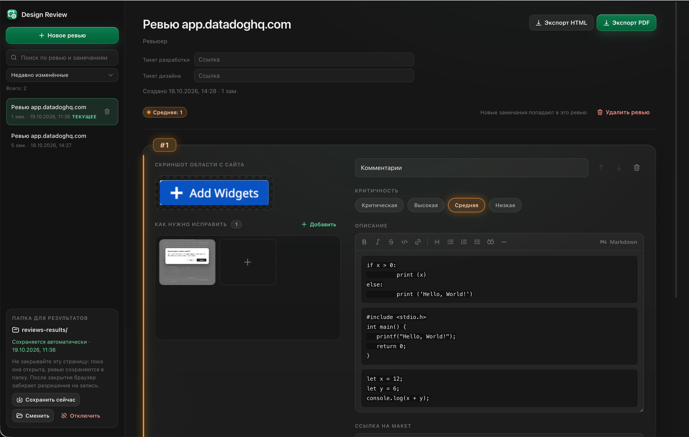
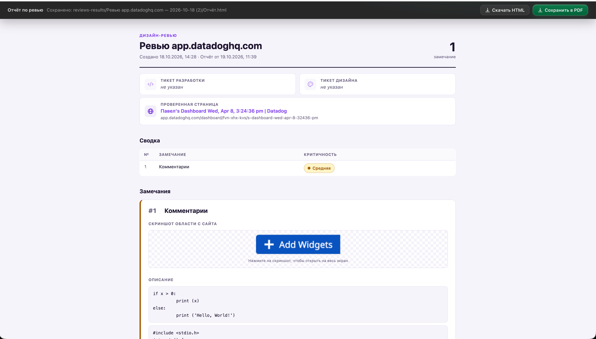

# Design Review Checker

<!-- badges:start -->
[](#установка)

[](https://github.com/allakin/Design-review-checker/releases)
[](https://github.com/allakin/Design-review-checker/actions/workflows/tests.yml?query=branch%3Amain)
[](https://github.com/allakin/Design-review-checker/actions/workflows/tests.yml?query=branch%3Amain)
[](https://github.com/allakin/Design-review-checker/actions/workflows/tests.yml?query=branch%3Amain)
[](https://github.com/allakin/Design-review-checker/actions/workflows/tests.yml?query=branch%3Amain)
[](https://github.com/allakin/Design-review-checker/actions/workflows/tests.yml?query=branch%3Amain)
[](https://github.com/allakin/Design-review-checker/actions/workflows/tests.yml?query=branch%3Amain)
[](https://github.com/allakin/Design-review-checker/actions/workflows/tests.yml?query=branch%3Amain)
[](https://github.com/allakin/Design-review-checker/actions/workflows/tests.yml?query=branch%3Amain)
[](https://github.com/allakin/Design-review-checker/actions/workflows/tests.yml?query=branch%3Amain)
[](https://github.com/allakin/Design-review-checker/actions/workflows/tests.yml?query=branch%3Amain)
[](https://github.com/allakin/Design-review-checker/actions/workflows/tests.yml?query=branch%3Amain)
<!-- badges:end -->

**Расширение для браузера**, чтобы проводить дизайн-ревью вёрстки прямо на живой странице: сравнивать реализацию с макетом, фиксировать расхождения и отдавать разработчику готовый отчёт. Работает в Яндекс Браузере, Chrome, Edge, Arc и других браузерах на Chromium (Manifest V3).







### Пример отчёта

<video src="examples/Screen%20Recording%202026-10-19%20at%2011.40.00.mov" controls width="100%"></video>

[Смотреть видео с примером отчёта](examples/Screen%20Recording%202026-10-19%20at%2011.40.00.mov)

## Зачем это нужно

Обычное дизайн-ревью — это десятки ручных скриншотов, обрезка в редакторе, переписывание отступов и цветов из DevTools и сборка всего этого в тикет. Замечания теряются, скриншоты не совпадают с описанием, а разработчику приходится заново искать, о каком блоке речь.

Design Review Checker сводит это к нескольким кликам:

- **Точный скриншот блока, а не всего экрана.** Наводите курсор на элемент — расширение снимает только его, даже если он выше экрана. Можно снять открытое меню, попап, `<select>` или произвольную область.
- **Стили и токены рядом со скриншотом.** К каждому замечанию автоматически прикладываются размеры, отступы, типографика, цвета в HEX, CSS-переменные (`var(--…)` → итоговое значение) и контраст текста по WCAG — не нужно открывать DevTools.
- **Селектор элемента и страница.** Разработчик сразу видит, какой это блок и где он находится.
- **Один отчёт на всё ревью.** HTML-файл со встроенными скриншотами или PDF с тикетами разработки и дизайна в шапке — можно приложить к задаче или отправить по почте.
- **Всё остаётся у вас.** Данные хранятся локально и сохраняются в папку `reviews-results`; расширение ничего не отправляет в сеть.

**Для кого:** дизайнеры, проверяющие вёрстку перед релизом; QA и фронтенд-разработчики, сверяющие реализацию с макетом; менеджеры, которым нужен понятный список правок по задаче.

## Как это работает

1. Создаёте ревью: название, ревьюер, ссылки на тикет разработки и тикет дизайна.
2. Выделяете элемент на странице: блок подсвечивается при наведении, выбирается кликом.
3. Расширение делает скриншот только этого элемента.
4. Заполняете название, описание, критичность и ссылку на макет.
   Описание пишется в визуальном редакторе с поддержкой Markdown: панель форматирования (жирный, курсив, зачёркнутый, код, ссылка, заголовок, списки, чек-лист, цитата, разделитель) и привычные сокращения при наборе: `**жирный**`, `_курсив_`, `` `код` ``, `# ` заголовок, `- ` список, `1. ` нумерация, `[] ` чек-лист, `> ` цитата, ` ``` ` блок кода. Кнопка «Markdown» переключает на исходный текст разметки. В отчёте HTML и PDF описание отображается отформатированным.
   В блок «Визуальные пояснения» под скриншотом добавляете картинки: как должно быть, референсы, фрагменты макета — кнопкой «Добавить», перетаскиванием или вставкой из буфера (⌘V / Ctrl+V). Картинок сколько угодно, блок не растёт по высоте, а прокручивается. Клик по картинке открывает слайдшоу.
5. Экспортируете всё ревью в **HTML** или **PDF**. В HTML визуальные пояснения показаны лентой со слайдшоу, в PDF они идут друг под другом.

## Установка

**Яндекс Браузер**

1. Откройте `browser://extensions` (или «≡ → Дополнения → Подробнее о дополнениях»).
2. Включите **«Режим разработчика»** в правом верхнем углу.
3. Нажмите **«Загрузить распакованное расширение»** и выберите эту папку (в ней лежит `manifest.json`).
4. Закрепите иконку расширения на панели.

**Chrome / Edge:** то же самое через `chrome://extensions` / `edge://extensions`.

Чтобы ревьюить локальные `file://` страницы, в карточке расширения включите «Разрешить доступ к адресам файлов».

## Первый запуск: папка reviews-results

Результаты ревью по умолчанию хранятся в папке `reviews-results` внутри папки расширения:

```
Design review checker/
├── manifest.json
├── …
└── reviews-results/        ← сюда пишутся ревью
    └── .gitkeep
```

Папка лежит в репозитории (через `.gitkeep`), а её содержимое исключено в `.gitignore`. Поэтому после `git clone` она уже есть, а результаты ревью в коммиты не попадают.

Браузер разрешает расширению писать на диск только в папку, которую пользователь один раз укажет сам. Поэтому перед первым ревью:

1. Создайте ревью в окне расширения: сразу откроется страница «Подключите папку reviews-results». Её же открывает кнопка «📁 Подключить reviews-results».
2. Нажмите «Выбрать папку reviews-results» и укажите `reviews-results` в папке расширения. Можно выбрать и саму папку расширения: `reviews-results` в ней подхватится автоматически.

Пока папка не подключена, выбор элементов не запускается. Переподключить или сменить папку можно на странице ревью в блоке «Папка для результатов» → «Сменить».

### Переустановка расширения и своя папка для результатов

При удалении расширения браузер стирает его хранилище: список ревью и подключённая папка пропадают, а файлы в `reviews-results` остаются. Чтобы вернуть ревью, нажмите в окне расширения «Восстановить ревью из папки» (кнопка видна под формой нового ревью, пока папка не подключена) или просто подключите папку заново — расширение прочитает `review.json` и скриншоты из всех подпапок и восстановит ревью, которых нет в списке. Даты сохраняются исходные, автосохранение продолжает писать в те же подпапки. Ревью, которые уже есть в расширении, не перезаписываются.

По кнопке «Восстановить ревью из папки» папка открывается только для чтения: браузер не спрашивает про запись, пока она не нужна. Новые изменения записываются в папку, пока открыта страница ревью (см. «Сохранение в папку на диске»).

- Если результаты лежат не в `reviews-results` (например, папку переименовали или перенесли), выберите ту папку: если в ней есть сохранённые ревью, расширение использует её как есть и не создаёт внутри новую `reviews-results`.
- Если в выбранной папке ревью нет, на странице подключения появится подсказка «укажите ту папку», а на странице ревью — «Нажмите «Сменить» и укажите ту папку».
- Папки с повреждённым `review.json` и пропавшие скриншоты перечисляются в итоге восстановления: замечания без найденного скриншота восстанавливаются без картинки.

## Как пользоваться

| Действие | Как |
|---|---|
| Создать ревью | Иконка расширения → название, ревьюер, ссылки на тикеты разработки и дизайна → «Создать ревью» |
| Выбрать элемент | «🎯 Выбрать элемент на странице» или `Alt+Shift+D` (без активного ревью хоткей создаст его сам) |
| Точнее выбрать блок | `↑`: родительский элемент, `↓`: обратно к дочернему, `Enter` или клик: выбрать, `Esc`: отмена |
| Снять область | В режиме выбора зажмите кнопку мыши и протяните рамку: снимается прямоугольник экрана как есть |
| Снять открытое меню / попап | «⏱ 3 с» в окне расширения: за 3 секунды откройте меню, потом выбирайте. Или откройте меню и нажмите `Alt+Shift+D` |
| Сохранить замечание | «Сохранить» или `⌘/Ctrl+Enter`; затем «Ещё элемент», чтобы продолжить |
| Отредактировать | Иконка → «Открыть и редактировать»: правка полей, порядок, удаление, переключение между ревью |
| Отформатировать описание | Страница ревью → поле «Описание»: панель форматирования или сокращения Markdown при наборе (`**жирный**`, `- ` список, `[] ` чек-лист, ` ``` ` блок кода); `⌘/Ctrl+K` — ссылка; «Markdown» — правка исходного текста разметки |
| Добавить визуальные пояснения | Страница ревью → блок «Визуальные пояснения» под скриншотом: «Добавить», перетащить файлы или вставить из буфера `⌘/Ctrl+V` (картинка попадёт в замечание, где стоит курсор или над которым мышь); клик по картинке — слайдшоу, крестик на превью — удалить |
| Экспорт | В окне расширения выберите HTML или PDF → «Экспортировать» |
| Сменить папку результатов | Страница ревью → блок «Папка для результатов» → «Сменить» |
| Отвязать папку | Там же → «Отключить»: файлы на диске остаются, новые изменения туда не пишутся; для новых ревью папку нужно подключить заново |
| Восстановить ревью после переустановки | Окно расширения → «Восстановить ревью из папки» → укажите `reviews-results` или папку, где лежат ревью (см. «Переустановка расширения и своя папка для результатов») |
| Дописать несохранённое в папку | Окно расширения → строка папки: «запросить» откроет страницу ревью, где доступ возвращается первым кликом; «сохранить» дописывает сразу |
| Найти ревью | Страница ревью → поле поиска в левой панели: по названию, ревьюеру, ссылкам на тикеты, названиям замечаний и страниц; можно несколько слов, `Esc` очищает |
| Отсортировать список | Там же: «Недавно изменённые», «Сначала новые / старые», «По названию», «Больше замечаний» — выбор запоминается |
| Удалить ревью из списка | Наведите на ревью в левой панели → корзина. Как и «Удалить ревью» в шапке, удаляет и его папку в `reviews-results` |

**HTML** — один самодостаточный файл со встроенными скриншотами: его можно отправить по почте или приложить к задаче.
**PDF** — откроется окно печати браузера, выберите «Сохранить как PDF». Титульная страница содержит сводку, дальше каждое замечание на своей странице.

Горячую клавишу можно поменять ссылкой «⌨ Изменить горячую клавишу» в окне расширения (откроется `browser://extensions/shortcuts`). На macOS сочетание по умолчанию — ⌥ Option + ⇧ Shift + D. Если браузер не назначил его из-за конфликта, в окне расширения появится предупреждение со ссылкой «Назначить».

## Стили и данные элемента

При выборе элемента расширение собирает вычисленные стили и показывает их в форме замечания (блок «Стили и данные элемента»; кнопка «Копировать CSS» копирует правило, где свойства через токены записаны как `var(--…)`, а переменные — с итоговыми значениями в комментариях), на странице ревью, в отчёте HTML/PDF и в `review.json`:

- **Размер**: width, height, min/max.
- **Отступы**: padding, margin, gap.
- **Типографика**: font-family, size, weight, line-height, letter-spacing, выравнивание, регистр.
- **Цвета**: цвет текста, фон, градиенты, opacity. Все цвета в HEX с образцом.
- **Рамка**: border, border-radius, outline.
- **Эффекты**: box-shadow, filter, transform, cursor.
- **Раскладка**: display, position, flex/grid, z-index, overflow.
- **Атрибуты**: id, class, role, aria-*, data-testid/qa, href, alt и т.п.
- **CSS-переменные**, в трёх группах:
  - *Свойства через переменные*: `text-decoration: var(--action-hover-underline) → underline`.
  - *Переменные элемента*: объявленные в правилах элемента, например `--action-contrast-outline: var(--form-border, var(--ui-border)) → #D0D5DD`.
  - *Переменные из родителей*: токены (обычно с `:root`), на которые ссылается элемент, с итоговыми значениями; незаданные помечены «не задана».

  Учитываются `@media`, `@supports`, `@layer`, вложенные правила, Shadow DOM и inline-стили. CSS с другого домена без CORS браузер расширению не отдаёт: в блоке будет пометка, сколько таких таблиц пропущено. Каскад считается упрощённо (последнее объявление и `!important`, без учёта специфичности), а итоговые значения берутся из браузера и всегда точные.
- **Контраст текста** по WCAG: коэффициент, AA/AAA, цвет текста и реального фона под ним (с учётом полупрозрачных фонов родителей). Если под текстом градиент или картинка, контраст помечается как приблизительный.

Показываются только значимые значения: нулевые отступы, `none`, `normal` и т.п. скрыты.

## Скрытые блоки: меню, попапы, select

- **Кастомные выпадающие списки, меню, тултипы** — обычные элементы страницы, их можно снять. В режиме выбора нажатия не доходят до сайта, поэтому открытое меню не закроется. Откройте меню, нажмите `Alt+Shift+D` и выберите меню или его пункт. Если меню закрывается, когда открывается окно расширения, используйте «⏱ 3 с». Чтобы снять триггер вместе с меню, протяните рамку области.
- **Нативный `<select>`**: его выпадающий список рисует операционная система, и снять его скриншотом нельзя. При выборе `<select>` расширение само рисует под ним копию списка (опции, группы, выбранный и недоступные пункты) и снимает select вместе с ней. В замечании и отчёте это помечено.

## Отчёт

- В шапке отчёта (HTML и PDF) стоит блок «Задачи»: тикет разработки и тикет дизайна. Ссылки кликабельны, в том числе в PDF; если ссылки нет, написано «не указан». Ссылки можно добавить или поменять на странице ревью. Под ними — карточки «Проверенная страница»: название страницы, короткий адрес без параметров и полная ссылка по клику (по одной карточке на каждую страницу, где делались замечания).
- Каждое замечание состоит из подписанных блоков: «Скриншот области с сайта», «Описание», «Визуальные пояснения» (если добавлены) и данные элемента — макет, страница, селектор, стили.
- Описание выводится отформатированным, как в редакторе: заголовки, списки, чек-листы с отметками, цитаты, блоки кода с подписью языка, кликабельные ссылки.
- Визуальные пояснения в HTML — лента фиксированной высоты: клик открывает слайдшоу только по картинкам этого замечания (`←`/`→` листают). В PDF все картинки идут друг под другом, без прокрутки.
- В HTML-отчёте клик по скриншоту открывает его на весь экран. `←`/`→` листают скриншоты, клик по картинке или `Z` переключает «вписать» / «100%», кнопка «⛶ Во весь экран» или `F` включает полноэкранный режим браузера, `Esc` закрывает. Это работает и в скачанном файле, открытом с диска.

## Сохранение в папку на диске

После подключения папки (см. «Первый запуск») любое изменение ревью через секунду автоматически записывается в `reviews-results`:

```
reviews-results/
  <Название ревью> — 2026-10-16/
    Отчёт.html        самодостаточный отчёт со скриншотами (то же, что экспорт HTML)
    review.json       данные ревью: тикеты, замечания, критичность, ссылки, селекторы
    screenshots/
      01 — <название замечания> — a1b2c3.png
      01 — Визуальное пояснение — d4e5f6.png
```

- Экспорт HTML при выбранной папке тоже пишет отчёт в неё, а не в «Загрузки».
- PDF сохраняется через окно печати: путь выбираете там. Браузер обычно запоминает последнюю папку.
- Новое ревью не пишется поверх чужой подпапки с тем же именем, даже если расширение о ней не знает (например, после переустановки): для него создаётся «(2)».
- Кнопка «Удалить ревью» на странице ревью удаляет и его папку в `reviews-results` (отчёт, `review.json`, скриншоты); в окне подтверждения видно, какая папка будет удалена. Остальные ревью и `.gitkeep` не затрагиваются.
- Писать в выбранную папку браузер разрешает, только пока открыта страница расширения, и только после клика на ней. Окно расширения и фоновый скрипт не в счёт, а разрешить запись навсегда Яндекс Браузер расширению не даёт: после закрытия страниц он снова спрашивает «Save changes…?». Поэтому замечания, добавленные с сайта, попадают в папку, когда вы откроете страницу ревью и кликнете на ней. Когда страница ревью закрыта, окно расширения показывает «Нужно разрешение на запись в «reviews-results»: запросить» (и сколько ревью ещё не сохранено) — по клику откроется страница ревью, где доступ возвращается первым кликом. Поэтому во время ревью держите страницу ревью открытой — об этом напоминают окно расширения и блок папки.
- Страницы ревью и отчёта при открытии сами дописывают в папку всё, что накопилось, пока они были закрыты. Если доступа нет, блок папки пишет «Нет доступа к папке. Кликните в любом месте страницы» — первый клик возвращает доступ (или браузер спросит разрешение), и несохранённое дописывается. Если доступ есть, но что-то не записано, окно расширения показывает «Не сохранено в «reviews-results»: N ревью — сохранить» и по клику дописывает само.

- В `review.json` описание хранится в Markdown, а визуальные пояснения — списком с путями к файлам в `screenshots/` (сами картинки в JSON не встраиваются). Имя файла пояснения не зависит от его места в списке: удаление одной картинки не трогает остальные.
- Записи в папку идут строго по очереди — и с фоновым скриптом, и со страницами расширения: сначала пишутся новые файлы, `review.json` и отчёт, и только потом удаляются лишние. Если запись прервётся, на диске не останется ссылок на удалённые картинки; через пару секунд открытая страница ревью сама допишет то, что не попало на диск.
- Если файлы расширения обновили, а само расширение не перезагрузили, фоновый скрипт продолжает работать на старом коде и пишет в папку данные в старом формате. Страница ревью это замечает и показывает «Расширение обновилось, но не перезагружено» с кнопкой «Перезагрузить расширение»: после перезагрузки страница откроется снова, а ревью перезапишутся новым кодом.

Подробности — [docs/file-access-permissions.md](docs/file-access-permissions.md).

## Как устроен скриншот

- Снимается видимая область вкладки (`captureVisibleTab`) и обрезается по границам элемента с учётом DPR и масштаба страницы.
- Если блок выше экрана, страница прокручивается, снимки склеиваются (до 25 кадров), после чего прокрутка возвращается на место.
- На время съёмки скрываются фиксированные и «липкие» элементы (шапки, чаты, баннеры), если они не входят в выбранный блок.
- По ширине элемент обрезается по видимой области. Блоки внутри собственного скролл-контейнера снимаются в пределах видимой части: в отчёте будет пометка «снят не целиком».

## Ограничения

- На служебных страницах (`browser://`, `chrome://`, магазин расширений) браузер запрещает расширениям работать.
- Содержимое кросс-доменных `iframe` выбирается только целиком, как один блок.
- Данные хранятся локально в `chrome.storage` этого профиля браузера и ничего не отправляется в сеть. Если удалить расширение, ревью пропадут из его списка. Файлы в папке для результатов останутся, и из неё ревью можно восстановить (см. «Переустановка расширения и своя папка для результатов»). Ревью, которые ни разу не попали в папку, восстановить нельзя.
- Писать в папку на диске браузер разрешает, только пока открыта страница расширения. Поэтому замечания, сделанные при закрытой странице ревью, ждут, пока вы её откроете (см. «Сохранение в папку на диске»).
- В редакторе описания часть действий (сокращения Markdown, списки, чек-листы) не попадает в историю отмены `⌘/Ctrl+Z`. Форматирование, вставленное из других программ, упрощается до того, что умеет Markdown описания: цвета, шрифты, таблицы и картинки отбрасываются.
- Большие визуальные пояснения уменьшаются до 2400 px по длинной стороне, WebP и GIF сохраняются как PNG: картинки хранятся в расширении и встраиваются в HTML-отчёт.

## Структура

```
manifest.json         MV3-манифест
background.js         сервис-воркер: внедрение скрипта, снимки вкладки, сохранение
content/content.js    подсветка, выбор элемента, скриншот, форма (Shadow DOM)
popup/                окно расширения: ревью, список замечаний, экспорт
pages/review.*        полноэкранное редактирование ревью
pages/md-editor.js    редактор описания: визуальный режим и режим Markdown
pages/report.*        отчёт: скачивание HTML и печать в PDF
pages/setup.*         подключение папки reviews-results, восстановление ревью, разрешение записи
reviews-results/      результаты ревью (содержимое в .gitignore)
lib/store.js          хранилище ревью
lib/report.js         генерация HTML-отчёта
lib/markdown.js       Markdown описаний: безопасный рендер в HTML и обратное преобразование
lib/code-version.js   отпечаток кода: страница ревью замечает фоновый скрипт на старом коде
lib/folder.js         автосохранение в выбранную папку на диске, восстановление ревью из папки
lib/url.js            проверка ссылок
docs/                 заметки для разработчиков (доступ к папке и разрешения браузера)
lib/icons.js          иконки Gravity UI для страниц расширения и отчёта
content/icons.js      те же иконки для контент-скрипта
lib/constants.js      уровни критичности
icons/                иконки расширения (PNG) и их исходники (icon.svg, icon-16.svg)
tests/                автотесты (node:test + jsdom), см. «Тесты»
scripts/badges.js     прогон наборов тестов, блок плашек в README и JSON для них
scripts/changelog-prepend.js  CHANGELOG.md и черновик релиза на GitHub, см. «Релизы»
package.json          зависимости и команды для тестов (на работу расширения не влияет)
.githooks/            pre-commit: тесты перед каждым коммитом
.github/              CI: тесты на каждый push и pull request, черновик и публикация релиза
```

## Тесты

Автотесты проверяют расширение целиком: от хранилища и записи на диск до контент-скрипта и страниц расширения. Прогоняйте их после любого изменения: так сразу видно, если что-то сломалось или потерялось.

```bash
npm install          # один раз: ставит jsdom (нужен Node.js 22.22+ / 24.15+)
npm test             # все тесты, ~10 секунд
npm run test:watch   # перезапуск при сохранении файлов
npm run test:coverage  # покрытие кода
npm run badges       # прогнать наборы по отдельности и сверить блок плашек в README
npm run changelog-prepend  # собрать раздел CHANGELOG.md для текущей версии (см. «Релизы»)
npm run hooks:install  # тесты перед каждым git commit (после git init)
```

Тесты не требуют браузера: API `chrome.*`, File System Access API и IndexedDB заменены моками в памяти (`tests/helpers/`), а DOM даёт jsdom. Код расширения для тестов не меняется. Контент-скрипт загружается в jsdom-страницу как есть, и наружу дополнительно выставляются его внутренние функции.

| Набор | Файлы | Что проверяет |
|---|---|---|
| Store | `tests/unit/store.test.js` | создание, правка, удаление ревью и замечаний, порядок, текущее ревью, поисковый индекс, параллельные записи без потерь |
| Report | `tests/unit/report.test.js` | HTML-отчёт: шапка, тикеты, страницы, сводка, склонения, экранирование и защита от XSS, самодостаточность файла, просмотрщик скриншотов |
| Folder | `tests/unit/folder.test.js` | папка `reviews-results`: подключение, имена подпапок, `review.json`, скриншоты, очистка, статусы автосохранения, удаление, восстановление ревью из папки |
| Background | `tests/unit/background.test.js` | сообщения, запуск выбора, служебные страницы, внедрение скриптов, лимит снимков, горячая клавиша, автосохранение |
| Content script | `tests/unit/content.test.js` | цвета, контраст WCAG, CSS-переменные и каскад, селекторы, `<select>`, режим выбора, скриншот, форма, сохранение, снимок области |
| Utils | `tests/unit/constants.test.js`, `tests/unit/url.test.js` | уровни критичности, проверка и очистка ссылок |
| Popup | `tests/pages/popup.test.js` | окно расширения: создание ревью, выбор элемента, экспорт, список ревью, состояние папки |
| Pages | `tests/pages/review.test.js`, `tests/pages/report-setup.test.js` | страница ревью (поиск, сортировка, правка, удаление, папка), страница отчёта, первый запуск |
| Release | `tests/unit/changelog.test.js` | CHANGELOG.md и черновик релиза: разбор коммитов, группы, русские формулировки и склонения, повторная сборка без дублей, черновик и публикация через GitHub API |
| Integrity | `tests/integrity/project.test.js` | манифест и все пути, синтаксис, импорты, CSP, иконки, синхронность копий кода в `content.js`, типы сообщений, этот README и плашки |

Тесты целостности ловят то, что легко упустить при правках. Например: копия списка критичностей или `normalizeUrl` в `content/content.js` разошлась с `lib/`; в коде используется несуществующая иконка; файл переименован, а ссылка в манифесте или README осталась старой; новый тестовый файл не попал ни в одну плашку.

Отдельно помечены как `todo` известные особенности: они видны в отчёте тестов, но прогон не роняют.

- `normalizeUrl('mailto:a@b.ru')` превращается в `https://mailto:a@b.ru/`, а `normalizeUrl('123')` — в `https://0.0.0.123/`.
- Описание в `manifest.json` занимает 143 символа, а Chrome Web Store принимает не больше 132.

Если в репозитории на GitHub включены Actions, тесты запускаются на каждый push и pull request на Node.js 22, 24 и 26 (`.github/workflows/tests.yml`). Запустить прогон вручную можно на вкладке Actions → Tests → Run workflow.

Плашки в начале README живые: в файле только адреса, а состояние shields.io берёт при каждом показе страницы, поэтому README не нужно перекоммитивать. Любая плашка тестов ведёт на страницу прогонов `tests.yml` в `main`.

- **All tests** — статус последнего прогона `tests.yml` в `main`.
- **Наборы** (Store, Popup и остальные) — после каждого push в `main` workflow запускает `npm run badges -- --out <папка>`: наборы прогоняются по отдельности, и результат каждого записывается в JSON в служебную ветку `badges` (она перезаписывается одним коммитом). «passing» появляется только после реального успешного прогона, при падении на плашке «failing» и счёт, например `failing 27/29`. shields.io кэширует плашки около 5 минут.
- **release** — последний опубликованный релиз из [GitHub Releases](https://github.com/allakin/Design-review-checker/releases): самый старший тег в формате semver (`v1.2.3`), черновики и пре-релизы не учитываются.

Чтобы workflow мог писать в ветку `badges`, в настройках репозитория (Settings → Actions → General → Workflow permissions) должно быть разрешено «Read and write permissions». Если добавили или переименовали набор в `scripts/badges.js`, запустите `npm run badges`: он обновит блок плашек в README, а тест целостности проверит, что блок не отстал.

## Релизы

Работа идёт в ветке `develop`, релиз выходит после принятия pull request из `develop` в `main` (`.github/workflows/release.yml`).

1. **Каждый push в `develop`.** `npm run changelog-prepend -- --draft --bump` собирает по коммитам с последнего релиза раздел для версии из `manifest.json`. Скрипт вставляет его в начало `CHANGELOG.md` и создаёт или обновляет черновик релиза `vX.Y.Z` на GitHub. Если эта версия уже выпущена, а с неё менялись файлы расширения (`manifest.json`, `background.js`, `content/`, `lib/`, `popup/`, `pages/`, `icons/`), бот сам поднимает версию в `manifest.json`, `package.json` и `package-lock.json`: есть ломающие изменения → major (`2.0.0`), есть «Новое» → minor (`1.1.0`), иначе → patch (`1.0.1`). Версия и CHANGELOG.md уходят в `develop` одним коммитом бота: после него сделайте `git pull`. Если менялись только тесты, CI или документация, черновик не собирается: в сводке прогона будет заметка, что новый релиз не нужен.
2. **Pull request `develop → main` принят.** Черновик публикуется как есть, тег ставится на merge-коммит в `main`, плашка release подхватывает новый релиз сама. Если версию в `manifest.json` не подняли, а в `main` пришли правки расширения (`manifest.json`, `background.js`, `content/`, `lib/`, `popup/`, `pages/`, `icons/`), job падает и релиз не публикуется. Если пришли только тесты, CI или документация, job завершается успешно без релиза: расширение не изменилось.

Пока версия не выпущена, бот только повышает её, если новые коммиты требуют уровня выше: поднял до `1.0.1`, потом пришло «Новое» — станет `1.1.0`, а черновик и раздел CHANGELOG.md переименуются. Понижать версию бот не будет: чтобы выпустить, например, `2.0.0`, поднимите `version` в `manifest.json`, `package.json` и `package-lock.json` вручную.

Черновик пишется по-русски и коротко: строка «Коротко: 2 новые возможности и 1 исправление», затем пункты по группам (ломающие изменения, новое, исправления, улучшения, изменения). Тесты, CI и рефакторинг сворачиваются в одну строку. Текст пунктов берётся из сообщений коммитов:

- `feat:`, `fix:`, `perf:`, `refactor:`, `docs:`, `test:`, `ci:`, `chore:` ([Conventional Commits](https://www.conventionalcommits.org/ru/)) задают группу, `feat!:` или `BREAKING CHANGE:` в теле — ломающее изменение. Без префикса группа определяется по глаголу: «Исправить …» — исправления, «Добавить …» — новое.
- «Добавить экспорт в PDF» превращается в «Добавили экспорт в PDF». В релиз попадает только первое предложение, а префикс и скоуп отбрасываются.
- Строка `Релиз: <текст для пользователей>` в теле коммита заменяет текст пункта. `Релиз: -` скрывает коммит из релиза. Коммиты бота и коммиты «Поднять версию до …» не попадают в релиз сами.
- Пункты без русского текста (например, «Initial commit») скрипт показывает в логе как предупреждение: их стоит переписать.

Раздел текущей версии в `CHANGELOG.md` и текст черновика пересобираются на каждый push в `develop`. Ручные правки в них до публикации перезаписываются, поэтому надёжнее задавать формулировку строкой `Релиз:` в коммите. Правки черновика, сделанные после последнего push в `develop`, при публикации сохраняются.

```bash
npm run changelog-prepend                 # обновить CHANGELOG.md локально
npm run changelog-prepend -- --dry-run    # показать раздел и черновик, ничего не меняя
```

## Иконки

Иконки интерфейса — [Gravity UI Icons](https://gravity-ui.com/ru/icons) (`@gravity-ui/icons` 2.23.0, [MIT](https://github.com/gravity-ui/icons?tab=MIT-1-ov-file), © YANDEX LLC; текст лицензии — `icons/gravity-ui-LICENSE.txt`). SVG встроены в код, расширение ничего не загружает из сети.
